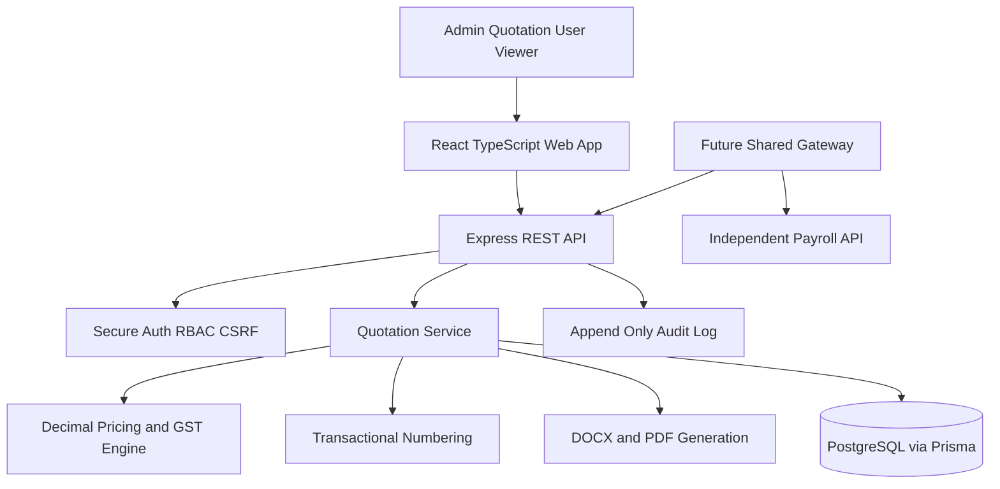

# Quotation Module Architecture

## Merge strategy

The future combined product should use a gateway or shared shell. Quotation and payroll keep separate service modules and tables. A central identity provider may issue short-lived signed claims containing organisation ID and permissions. Payroll permissions and quotation pricing permissions must remain distinct.

## Quotation states

- `DRAFT`: editable working record.
- `ISSUED`: client-ready snapshot; document generation marks a draft as issued.
- `REVISED`: superseded by an explicitly linked revision.
- `CANCELLED`: retained for audit and never reused for numbering.

## Calculation order

For each item: quantity x unit price = gross; discount is deducted; GST is calculated on taxable value. Same-state supply splits GST evenly into CGST and SGST. Interstate supply applies IGST. Freight is then added to the grand total. All money uses decimal arithmetic and half-up rounding to two places.
